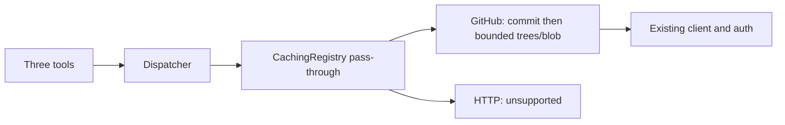

# Design

## Context

[Proposal](proposal.md) owns scope; the skills-mcp delta owns observable contracts. This design extends the existing layers without changing legacy skill fetching.

## Decisions and rationale

**Integration.** Extend both registry protocols and route the three tools through Dispatcher and uncached CachingRegistry forwarding. HTTP implements unsupported-operation failures. Reusing the decorator preserves one routing boundary; a parallel repository service would duplicate dispatch/authentication without benefit. No new modules, dependencies, configuration knobs or cache entries are needed.

**Snapshot traversal.** Resolve the configured ref through Commits once per browsing/reading operation, retaining commit SHA and root tree SHA. Descend exact path components through nonrecursive Trees by immutable SHA. Compared with Contents-based lookup or recursive enumeration, this avoids moving-ref/type races and limits work to ancestor directories. Validate paths before I/O, rejecting absolute paths, dotdot, control characters, backslashes and empty/interior-dot components; the listing root alone accepts empty path. Encode each accepted component as data, never URL syntax.

Interpret verified Git modes: 100644/100755 files, 040000 directories, 120000 symlinks, 160000 submodules. Listing labels the latter two unsupported; traversal never follows them. Unknown modes, malformed entries and incomplete trees fail explicitly rather than becoming empty successes. Legacy truncation-warning helpers remain unchanged.

**Representation.** Prefer provenance envelopes over bare text, preventing confusion between registries and mutable refs. Source is the allowlisted object `{registry,type,url,owner,repo,ref,skills_dir}`; URL is constructed from configured identity, not upstream redirects. Source discovery is local configuration reporting after restart, not canonical rename resolution. Reading returns `{source,path,commit_sha,content}`. Listing returns `{source,path,commit_sha,entries}`, sorted by path; entries carry repository-relative path, type and optional advertised byte size. Tool descriptions identify results as untrusted repository data, not executable instructions.

**Bounded transport.** Retain isolated github.py streaming, client/auth/retry reuse, redirect rejection, status-first processing, existing size/depth/entry/output budgets, size preflight, strict UTF-8/NUL rejection and sanitized error classification; buffered legacy helpers remain unchanged. No partial results.

config/model.py defines REPO_CLEANUP_MAX_SECONDS=1 and REPO_CLEANUP_RESERVE_FRACTION=0.1. At entry fix total deadline D=start+REPO_OPERATION_SECONDS (60s); reserve R=min(cap,fraction×operation-duration), work deadline D−R. Requests/backoff share that work deadline without resets. Every acquired response's first close gets attempted under a shield ending at min(now+R,D), including failures, retries, EOF and external cancellation; never add an unbounded fallback. HTTPX's is_closed is not proof cleanup finished. Cleanup timeout/failure aborts retries/results with a sanitized infrastructure error, preserving an existing primary failure; external cancellation propagates after cleanup. Cooperative scheduling/cancellation is necessary: an uncooperative close cannot be forcibly terminated or guaranteed complete.

Prefer proportional capped reserve over fixed subtraction: normally 59s work, while tiny test deadlines retain 90%; unlimited shielding violates the total budget.

## Risks and trade-offs

Uncached operations increase upstream traffic; depth and byte budgets bound individual work, not aggregate concurrency. Wide directories can be rejected despite containing a small desired file. Recovery is a narrower path or later retry, never silent partial success. Snapshot consistency applies within an operation, not across calls. No migration or cache invalidation is needed; legacy helpers stay isolated. Tests in test_adapters, test_caching_registry and test_integration cover new boundaries and unchanged legacy behavior; README explains operational limits. Implementation remains within the approved files.

## Component boundaries

| Part | Work kind | Completion evidence |
|---|---|---|
| Tools, protocols, dispatcher, forwarding | Application code | Provenance survives uncached routing |
| GitHub/HTTP adapters, errors, constants | Application code | Bounded snapshot reads and classified failures |
| Three approved test files | Application tests | Safety and legacy regression coverage |
| README | Documentation | Limits and trust boundary explained |
